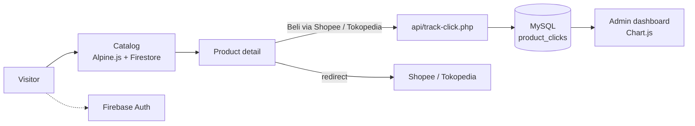

<h1 align="center">Bina Ragam</h1>

An online storefront that sends buyers to Shopee or Tokopedia to check out, and logs every outbound click for an admin dashboard.

## Overview

A small shop does not need its own payment flow if its customers already trust a marketplace. Bina Ragam is a catalog front end: visitors browse and filter products, open a product page, and press "Beli via Shopee" or "Beli via Tokopedia". Each press is recorded so the owner can see which products and which marketplace attract clicks. Accounts use Firebase; click analytics and the admin area run on PHP and MySQL (XAMPP).

All names, contact details, team members and product copy in this repository are sample placeholders.

## Features

- Product grid with search and category filter (Alpine.js), product detail page with marketplace buttons.
- Email/password registration and login through Firebase Authentication; user profiles stored in Firestore.
- Product reads and writes through a `FirebaseDB` helper (Firestore `products` collection with category, name, price and stock filters).
- `api/track-click.php`: PDO endpoint that validates the platform (`shopee` / `tokopedia`), counts clicks per product and platform in MySQL and exposes aggregates on GET.
- Admin area (PHP session): dashboard with Chart.js, product, user and discount management pages.
- Local cart kept in `localStorage`, plus GSAP / AOS / Swiper animations on the landing pages.

## How it works

## Getting started

Not tested end to end; the steps below are read from the code.

Prerequisites: PHP 8 with MySQL (for example XAMPP) and a Firebase project with Email/Password Authentication and Firestore enabled.

1. Copy the folder into the web root, e.g. `htdocs/binaragam`.
2. Create the database: `mysql -u root < database/schema.sql`. The PDO connection settings (`localhost`, `root`, empty password, database `binaragam_shop`) are written at the top of `api/track-click.php` and each `admin/*.php`; change them to match your server.
3. Put your own Firebase web config into `assets/js/firebase-config.js` and `js/firebase-config.js` (they contain `YOUR_...` placeholders; never commit real keys).
4. Set the admin credentials as environment variables before starting PHP / Apache:
   `BINARAGAM_ADMIN_EMAIL` and `BINARAGAM_ADMIN_PASSWORD`.
5. Open `http://localhost/binaragam/` and the admin login at `/admin/login.php`.

## Project context

Personal project, 2025 (solo). Built to practice combining a static front end, a managed auth service and a small PHP/MySQL back end.

## Limitations

- Work in progress. The Firebase layer is split across two config files (`assets/js/firebase-config.js` uses Firestore, `js/firebase-config.js` uses the Realtime Database), and some pages still use hard-coded sample products.
- The MySQL schema is inconsistent: `api/track-click.php` writes `click_count` / `last_clicked`, while `admin/dashboard.php` queries `total_clicks` / `clicked_at`, so the dashboard KPI cards do not read the API's data without adjusting one side. The Chart.js line chart currently plots fixed sample numbers.
- Admin access is a single environment-configured account, not a user table; the category list in the filter is generic sample data.
- No automated tests.

## License

MIT
